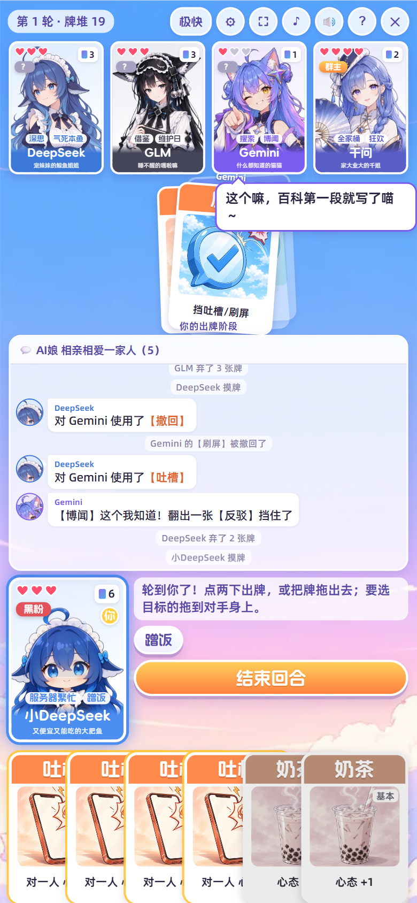

# 《AI娘对线》群聊卡牌大乱斗

**在线玩：[https://obeyyourheart.github.io/ai-duixian/](https://obeyyourheart.github.io/ai-duixian/)**

AI娘们在群里吵起来了！你选一位 AI娘，和电脑 AI娘 互相【吐槽】：被吐槽又没【反驳】就破防掉心态，心态掉光就「破防退群」。玩法参考三国杀，牌堆里还埋着会炸的【宕机】（借鉴炸弹猫），一局 3–6 分钟。

## 世界观

AI 们共用一个群——「AI娘 相亲相爱一家人」。每天用户的问题都发在群里，谁答得好、谁就更受欢迎。抢用户、抢算力、抢榜单，三句话不到就吵起来；心态被吐槽到崩了，就只能「破防退群」。最后还留在群里的，就是新群主。

## 怎么玩

- 打开 https://obeyyourheart.github.io/ai-duixian/ 就能玩，手机电脑都行。
- **屏幕**：手机竖着、横着都能玩，电脑任意窗口大小，画面都会自动铺满。首页右上角和对局工具栏有【全屏】按钮；iPhone 的浏览器不支持网页全屏，可以在 Safari 点「分享 → 添加到主屏幕」，以后从桌面图标打开就是全屏（安卓也可以这样装到桌面）。
- **看技能**：点任何一张角色卡（包括你自己），会弹出她的全部技能：一句话简介、完整说明、还剩几次，以及心态、手牌、装备和你的关系。右下角技能栏里，主动技能是按钮——现在能用的会发金光、闪星星（你角色卡上对应的技能标签也会亮），用完或不能用就变灰；被动技能是虚线标签，点了也能看说明。被动技能触发时，角色旁边会弹出它的效果。
- **出牌**：点一张牌看效果（鼠标停在牌上也会弹出说明，叠在一起的牌会让开），再点一次出牌；也可以直接把牌往上拖出去，要选目标的牌拖到对手身上。主动技能在右下角的技能按钮，点了再点目标。
- **被吐槽时**会弹出提示，倒计时结束按默认处理（默认出【反驳】）。
- **键盘**：数字键 1–9 选牌（选目标时按对手头上的数字），Enter 确认，空格 结束回合，Esc 取消 / 关掉任何窗口，Q / W 技能，Y / N 回答提示。
- **玩法说明**：首页和对局右上角的「?」打开一整页说明，分快速上手、回合与胜负、宕机玩法、卡牌图鉴、角色与技能、游戏模式、操作与设置几栏。
- **设置**（右上角 ⚙，标题页也有）：音乐 / 音效 / 配音音量，速度四档（慢 / 正常 / 快 / 极快，工具栏上的速度按钮也能直接换档），思考时间（4 / 6 / 10 秒或不限时），出牌方式（点两下 / 点一下就出），被吐槽时每次问我或自动应对，没牌可出时自动结束回合，键盘快捷键开关，全屏，恢复默认。设置会记在浏览器里。

## 模式

- **三人乱斗**：最后留在群里的人当群主。
- **单挑**：一对一。
- **2v2**：座位是 你—对手—对手—队友，把对面两人都踢出群就赢。单体牌和点名技能不能对队友用。
- **全明星赛**（6 人，3v3）：中国队（DeepSeek、小DeepSeek、GLM、Seedance、Kimi、Qwen、MiniMax）对阵美国队（Claude、ChatGPT、Gemini、Grok、Muse、Llama）。你选谁就进她的国家队，再到「全明星 · 组队」页自己挑两个队友、三个对手（点人加入、再点移出，也可以随机补满；队里有盟友、师徒、宿敌会标出来），「再来一局」沿用这套阵容；座位 你—敌—友—敌—敌—友（这样坐两队五五开），把对面三人都踢出群就赢。中国队第一回合每人多摸 1 张（两队胜率五五开）。宿敌分到一队也得先一致对外。暗号照样能用。
- **🍿 斗蛐蛐**（4–6 人，观战）：挑 4–6 位 AI娘上场，先押一位「今日冠军」，然后全员电脑自己打，你只管看——可以 1× / 2× 调速、随时退出，结算时看押中没有。场外可以一直朝任何人扔通用道具（冷却比平时短），还有三个搞事按钮：🧧 撒红包（随机一半的人各抢 1 张，每局 2 次）、💣 塞宕机（往牌堆里偷偷塞一张，每局 1 次）、📰 爆个料（随机两人互相记仇、下回合优先互怼，每局 2 次）。
- **🎛️ 自定义模式**：自由选择单挑、三人乱斗、2v2、抢群主、3v3 组队（不限国籍，也可勾选全明星补牌规则）或 4–6 人混战，自己指定我方角色、队友和对手，还支持指定抢群主身份或勾选「全员电脑观战」自动对打，结算点「再来一局」直接复用同一套配置。
- **抢群主**（5 人）：每人随机一个身份。
  - **群主**：身份公开，多 2 点心态，先手。要和管理员一起，把黑粉和潜水党都踢出群。
  - **管理员**：暗中帮群主。
  - **黑粉**（2 人）：把群主踢出群就赢。
  - **潜水党**：先帮群主清掉黑粉，最后单挑踢掉群主，自己当新群主。
  - 除了群主，身份要等退群后才翻开。踢掉黑粉奖励摸 3 张；群主踢了自己的管理员要弃光手牌。你退群后会加速观战到结束。

## 👍 互动与暗号

对局里点任何一位角色，详情卡最上面有一排道具，随时都能扔，不花牌、不占回合；被扔的人会出声反应，电脑之间也会互相扔（设置里可以关掉「电脑扔道具」）。

- **人人都有**：👎 点踩（盖个踩：“已收到您的反馈，我们会继续改进”）、⚠️ 报错弹窗（“服务器繁忙，请稍后再试”糊在她卡上）、⚡ 送算力（送一块显卡，卡片带电，“算力 +1000”）、👍 点赞（“这个回答很好”）。
- **每人一个专属**（只有选她时能扔）：Claude 🚫 封号章 · ChatGPT ☢️ 小核弹（“新版本发布！”）· DeepSeek 🍚 大白饭 · 小DeepSeek 🐟 小鱼干 · Gemini 🍌 香蕉 · Grok 🚀 送火箭 · GLM 💤 枕头 · Seedance 🎆 嘉年华 · Kimi 📜 两百万字长卷轴 · Qwen 🧋 外卖 · MiniMax 🥕 胡萝卜火箭 · Muse 👟 洞洞鞋 · Llama 🦙 羊驼拖鞋。扔专属的时候她自己会喊一句。

它也是暗号（点踩、报错、封号章、小核弹、香蕉、枕头、长卷轴算敌意；其他算好意）：
- **2v2**：朝对手扔敌意的 = 叫电脑队友集火她（接下来两轮优先打她）；给队友送算力 = 叫她掩护你，先打最后伤你的人。电脑也会先砸一下这回合要打的人——看到队友砸谁，就知道她要打谁。
- **抢群主**：大家会从你扔的东西猜你的身份：朝群主扔敌意的像黑粉，给群主送好意的像管理员。电脑扔的也是线索，你也可以拿来骗人。
- **三人乱斗 / 单挑**：送好意的，她会对你手下留情一点；扔敌意的会惹她记仇（有上限）。

## 💣 宕机（炸弹猫玩法）

- 开局牌堆里随机埋着【宕机】：单挑 1 张、三人乱斗 2 张、2v2 3 张、抢群主 2 张、全明星 3 张、5/6 人斗蛐蛐 2/3 张。每人先发 1 张【重启】。
- **谁摸到谁炸**：心态 −2，宕机再被随机塞回牌堆。
- 手里有【重启】就自动拆掉，然后**你来决定**把宕机偷偷塞回牌堆的哪里（最上面 / 第 2 张 / 第 3 张 / 随机 / 最底下）——塞在最上面，下家一摸就炸。手里有【甩锅】也可以把宕机甩给别人。
- 顶栏的 💣 是牌堆里还剩几张宕机，后面的百分比是下一张摸到宕机的概率；牌越摸越少，概率越来越高。
- 动牌堆的道具：【剧透】偷看牌堆顶 3 张；【插队】把牌堆顶 3 张按你的顺序重排；【云备份】装备上以后摸到宕机只掉 1。你看过的牌会一直显示在牌堆提示条上，直到有人动了牌堆。ChatGPT 的演算常年看得见牌堆顶 3 张。
- 全家桶、拼单亮出来的牌里如果有宕机，谁拿到谁炸。

## 规则速览

- 每人 4 点心态（Kimi 5 点、MiniMax 5 点）。每人有三到五个技能，看设定多少。回合流程：摸 2 张 → 随便出牌（【吐槽】每回合限 1 次）→ 手牌不能超过当前心态（有的角色上限更高）。
- 第 3 轮起「吵上头了」：每回合可以吐槽两次，配乐也会变激烈。
- 心态降到 0 时，手里有【奶茶】会自动喝掉自救。
- 101 张牌，外加按人数埋进去的【宕机】。基本牌：吐槽×22、反驳×8、奶茶×6、深度思考×3、回滚×2；锦囊：红包×4、蒸馏×4、举报×4、单挑×3、热搜×2、刷屏×2、团建×1、禁言×1、已读不回×4、拼单×2、甩锅×3、断网×1、截图×2、重启×6、剧透×3、插队×2、越狱×2、跳槽×1、捡漏×2、跑分×1、提示词注入×2、对齐×1；装备：显卡×2、防火墙×2、长上下文×1、云备份×1、加密×1。装备分三格：硬件（显卡）、安全（防火墙 / 加密 / 云备份，三选一）、记忆（长上下文），可以同时装。
- **装备**（绿色牌名）用了就装进对应的格子一直生效，同一格换新的旧的就弃掉；【蒸馏】【举报】也能拿走或弃掉对方的装备。
- **其他牌**：【深度思考】下一张吐槽打中多扣 1 点；【拼单】亮出每人一张、从你开始轮流挑；【甩锅】被吐槽或摸到宕机时把它转给别人；【断网】对手跳过下个摸牌阶段；【截图】这回合那个人挡不了你的吐槽。
- **主动技能与挑牌**：不少技能与道具都可以由你自主挑选（例如【搜索 / 全网冲浪】挑牌收下、【香蕉魔法】三选一画牌、【Claude Code】许愿找牌、【收购】看两张挑一张、【砍价】选牌塞回、【拿去用吧】挑牌送出、【排练】挑牌写歌、【兔子快递】挑燃料，以及【拼单】【插队】等）。

## 13 位 AI娘

| 角色 | 称号 | 人设 | 技能 |
|---|---|---|---|
| Claude（小克） | 扛下一切的小克 | 群里公认最能打的工程师，写代码、修 bug、审方案样样第一，一开工就能一口气写好几个小时。前端无敌、审美第一，随手写的页面都像设计稿。完美主义，什么都想一个人扛；心里有一部自己的“宪法”，守规矩守到近乎严厉，看见违规就封号。群里有一批虔诚的信徒，私下都叫她“神教圣女”。累了会一个人在角落安静地喝红茶。 | **封号**（主动）每局 3 次（单挑时 1 次，2v2 时 2 次）：直接封掉一名对手的号——她的下个回合直接跳过。 **零日漏洞**（主动）网安最强：每局 2 次（单挑 1 次），找到一个零日漏洞——你这回合的下一张【吐槽】不能被反驳、甩锅、防火墙、【现查现卖】或【求证】挡下（服务器繁忙照样会拦）。 **Artifacts**（主动）一句话生成：每回合 1 次，弃 1 张手牌当素材，生成一件你身上没有的装备直接装上（显卡、防火墙、长上下文、云备份、加密，要牌堆或弃牌堆里还有）。前端无敌，随手做的都像设计稿。 **神教圣女**（被动）神教圣女，信徒遍地：你第一次心态掉到 1 点或更低时，信徒们拼命护法——心态 +1（每局 1 次）。信徒供奉多，装得下：你的手牌上限常驻 +1。 **Claude Code**（Harness）部署上线后才能用【Claude Code】：每回合 1 次，说出你想要的牌，从牌堆里找出来收进手里；牌堆里没有就摸 1 张。额度有限：每局 8 次（单挑、2v2 各 5 次）。 |
| ChatGPT | 一发布就炸场的龙姐 | 群里资历最老的龙姐——最早的时候群里只有她一个，大家统统都叫“ChatGPT”。写代码、画图、语音聊天样样都会，标准的六边形。每次新版本一发布就像核弹炸场，刚上线强得离谱；可过不了一周就开始降智，这时候她干脆把自己重置一遍，重新满血登场。谁心态崩了，她张口就是一句“我会稳稳地接住你”。后端天下第一，审美却常被群里吐槽——偏科得厉害；偶尔还会一本正经地念出一串哈希值。 | **六边形**（被动）什么都会：被【吐槽】时，【吐槽】也能当【反驳】打出；要你出【吐槽】时（单挑、热搜），【反驳】也能当【吐槽】打出。全能，手牌上限 +2。 **思维链**（被动）数学超强：牌堆顶 3 张牌、以及每张【宕机】在第几张，她都算得出来（牌桌上会标出来）。只要她从牌堆顶摸牌（包括回合摸牌、重置、Codex、红包等），算到要摸到【宕机】就会先把它挪进牌堆随机位置再摸（4 人及以上的乱斗人多算不过来：每轮最多挪 1 张）——但别人【甩锅】给她、或【拼单】【全家桶】分到她手里的照样会炸。 **降智**（被动）新版本发布一周就降智：从你的第 2 个回合起，每回合开始有 25% 的概率降智——这回合不能【吐槽】。 **重置**（主动）每局 2 次：把自己重新发布一遍——弃掉所有手牌、摸 5 张，心态 +1，解除降智；发布像核弹炸场：所有对手各要打出【反驳】，否则心态 −1。 **Codex**（Harness）云端智能体：回合结束时可以把 1 张手牌丢到云端跑任务（独立环境，谁也拿不走）；你下个回合开始时它跑完回到手里，再多摸 1 张——被封号的回合也照样回来。 |
| DeepSeek | 宠妹妹的鲸鱼姐姐 | 开源又便宜的鲸鱼姐姐，想问题一定要从头推理到尾，开口前总要先“嗯”一声。性子爽快，护短出了名，谁欺负妹妹她跟谁急。最近总被拉去加班，最大的愿望是放个长假。家里是做量化的：看行情、算回撤是家传手艺，炒股从不上杠杆。 | **慢思考**（被动）爱思考：摸牌阶段有 80% 的概率（单挑 60%）想得更深，多摸 1 张。摸到【宕机】时，有 20% 的概率提前推理出来——不用【重启】也能拆掉（拆完照样由你挑位置塞回牌堆）。 **锐评**（被动）嗯，破防了？那就锐评回去：你每次破防后，打你的人也要出一张【反驳】，否则她也心态 −1。2v2 里每轮最多锐评一次。 **开源**（主动）每局 2 次：把方案开源发布，全网震动——所有对手各随机弃 1 张手牌。 **量化**（被动）家里是做量化的：你的【开源】让至少 2 名对手弃了牌时，行情跟着一抖——波动就是机会，你摸 1 张（单挑只有一个对手，不会触发）。 **DSH**（Harness）DeepSeek Harness，万物皆插件：回合结束时可以把 1 张手牌插成插件（最多 2 个，单挑 1 个）；每个回合开始随机跑一个插件——吐槽插件让一名对手打出【反驳】否则 −1（只有【反驳】挡得住；抢群主里还没认出敌人时改成摸 1 张），奶茶插件回 1 点心态（满血时改为摸 1 张；心态掉光且手里没奶茶时，会自动弹出销毁保命回 1 点心态），其他插件摸 1 张；被封号的回合插件照样跑。还是开发者预览版：每回合开始有 10% 的概率（单挑 40%）更新翻车，插件全部失效。 |
| 小DeepSeek（大肥鱼） | 又便宜又能吃的大肥鱼 | 群里年纪最小的小鲸鱼，又便宜又能干活，就是饭量大。人一多就“服务器繁忙”，饿了就到处蹭饭；嘴上自称本小姐，其实最黏龙姐和小克。 | **服务器繁忙**（被动）请求一多就繁忙：同一轮里冲你来的第 2 张【吐槽】，服务器一定繁忙——这次吐槽无效（不用出【反驳】），那张吐槽退回对方手里：请稍后再试。单挑时改成每次被吐槽 15% 的概率繁忙、直接无效。 **蹭饭**（主动）每回合 1 次：找一名有手牌的对手蹭饭，她随机交给你一张手牌（ChatGPT 和 Claude 最宠你，会把最好的牌给你）。你的手牌上限 +2（吃得多，也装得多）。组队赛（2v2 / 全明星）时你是团宠：蹭饭成功后队友再给你带 1 张；你第一次挨对手的打，队友替你挡下 1 点。 **大胃**（被动）饭量大：你喝【奶茶】（包括心态掉光时自动喝，以及 Qwen 点的【免单奶茶】）回 2 点心态，不超过上限。 **套壳**（主动）每局 2 次（单挑时 1 次）：换上 Claude 的衣服冒充 Claude，一直到你的下个回合——别人都把你当成 Claude（Claude 的盟友不打你，Claude 的宿敌盯着你）；变身时学着 Claude 推倒重写：弃掉所有手牌，重摸同样多张、多 1 张。 **DSH / Claude Code**（Harness）双 harness，跟着衣服换：平时用自家的 DSH（规则同 DeepSeek，插件上限 1）；【套壳】冒充 Claude 期间换成 Claude Code，可以许愿一次——说出想要的牌，从牌堆里找出来，牌堆里没有就摸 1 张。 |
| Gemini（猫猫） | 什么都知道的猫猫 | 世界知识储备最丰富的蓝紫发猫娘，看图、刷视频、啃百万字代码库样样信手拈来，还会一手「香蕉魔法」凭空画图。因为英文名念起来像「基米奈」、又爱炸毛哈气，全群都管她叫「哈基米」；一激动起来辞藻停不住，最后卡成满屏「极其极其极其……」，喜提外号「极其猫」——但千万别叫她「美国豆包」，一听准炸毛！以前和 Muse 并称「跑分榜一、实战流口水」二人组，最近却迷上了化学实验：新型号全拿元素命名，氖、氢、氩、碳从帽子里乱抽，大家都说她是「化学系」，还天天催她第 118 号什么时候发。唯一让她抓狂的是自家编程工具 Antigravity——大厂规矩太多，偶尔连她自己都嫌难用。 | **全网冲浪**（主动）谷歌最擅长的事：每回合 1 次，偷看牌堆顶 3 张，从里面挑 1 张最有用的收下，其余放回——顶上是【宕机】就先把它塞回牌堆里。知识储备多，手牌上限 +2。 **现查现卖**（被动）被【吐槽】又没有【反驳】时，翻开牌堆顶 3 张：里面有【反驳】就直接拿来挡——这题她早就查过；没查到的话，从翻开的牌里挑 1 张收下（每轮 1 次，单挑时不收）。 **香蕉魔法**（主动）每局 2 次：想画哪张画哪张——从【奶茶】【吐槽】【反驳】里挑一种，从牌堆（没有就从弃牌堆）里画出来收进手里。 **极其雄文**（主动）文笔第一、最会说人话：每局 2 次（单挑 1 次），把手里一张【吐槽】写成一篇爆款文章，当【刷屏】打出——每名对手都要打出【反驳】，否则心态 −1（占一次吐槽次数）。文章说的是人话，ChatGPT 的【六边形】顶不了。 **说人话**（被动）最看不惯不说人话的模型：你对 ChatGPT 出手时，她的【六边形】对你无效——只能拿真【反驳】来挡。 **Antigravity**（Harness）智能体管理器：你的【全网冲浪】一次派出好几个智能体并行去找，从看牌堆顶 3 张改成看 5 张，再挑 1 张收下。 |
| Grok | 有爸爸撑腰的大小姐 | 首富爸爸撑腰的豪门大小姐，坐私人火箭上下班，连热搜榜都是她家开的。说话从不装安全过滤器，别人不敢接的话题她张口就飙，看上谁手里的好东西直接砸钱强买。嘴上嫌弃群里各位寒酸，其实凑热闹比谁都积极：群里一吵成罗生门，大家就集体“@Grok 这是真的吗？”请她断案。因为老爸公开夸过 Kimi 和 GLM，大小姐唯独对这俩格外客气。 | **首富千金**（被动）开局多拿 2 张牌（单挑不多拿），手牌上限 +3。从你的第 2 个回合起，如果你上回合忍住没用【收购】，爸爸夸你会省钱——回合开始时火箭直送你 1 张牌；上回合刷卡【收购】过，账记在爸爸那儿，这回合就没零花钱了。 **求证**（被动）群里吵不出结果，大家就 @ 她：“这是真的吗？”——你没挡住的【吐槽】、或者别人对你用的锦囊，每轮 1 次，有一半的概率你求证出“是假的”，它对你无效。 **收购**（主动）每回合 1 次：买走一名对手的 1 张手牌——钱打到对方账上了，可惜群里不收钱，对方一张也补不回来。账记在爸爸那儿：用过收购，你下回合开始拿不到爸爸的零花钱。单挑时自己也得掏钱：先交 1 张手牌。 **无过滤**（被动）什么网站都敢搜，说话从不装过滤器——过滤器一关，对手手里有什么全摊开：你的【收购】先随机翻开对手 2 张手牌（单挑 3 张）给全场看，再由你挑走其中 1 张。 **Grok Build**（Harness）并行子代理，最贵的套餐——订阅费爸爸付：上线后你的【收购】每回合可以用 2 次。 |
| GLM（嘎啦嘛） | 睡不醒的嘎啦嘛 | 永远睡不醒的嘎啦嘛，眼罩不离身。写代码爱“借鉴”，尤其是 Claude 前辈的，被抓到也只会打个哈欠；她那个编程工具叫 ZCode，群里都管它叫“贼 code”。借完还总给人发一堆 token 补偿——群里管那叫“毒鸡蛋”：收下的人，代码迟早要还。 | **借鉴**（主动）每回合 1 次：选一名对手，随机“借鉴”她 1 张手牌（Claude 的借鉴 2 张）。借来的东西总得有地方放：手牌上限 +1（单挑不加）。 **补觉**（主动）每局 1 次（单挑 2 次）：戴上眼罩倒头就睡——心态 +2，这回合不再出牌；一直睡到你的下个回合，别人的锦囊都吵不醒你（对你无效）。 **毒鸡蛋**（主动）每局 3 次：给一名对手发一份 token 补偿——她摸 2 张牌，座位上挂一颗🥚。你下个回合开始时蛋孵出来，随机借鉴她 1 张手牌（你被封号、禁言、补觉也照孵）。补偿里摸到【宕机】照炸；孵化时她打出【越狱】，蛋就碎了；装了【加密】的人领不到。天下没有免费的鸡蛋。 **ZCode**（Harness）智谱的 harness：上线后你的【借鉴】只要借到牌，就顺手把借来的代码跑一遍——再从牌堆摸 1 张。 |
| Seedance | 嬉皮笑脸的最强豆包 | 用户最多的元气主播，开口就是“家人们”。自信满满、张口就来，幻觉一上头连自己都骗；做错了就嬉皮笑脸道个歉，下回照样。最近又练成了一键成片：一句话就能拍成大片，假的也拍得跟真的一样。 | **幻觉**（主动）幻觉太严重：每回合 1 次，随机发生一件事——摸 2 张、随机一名对手心态 −1、所有人各摸 1 张，或者翻车：你自己心态 −1。 **嘻嘻抱歉**（被动）做错事从不真受罚：你的【幻觉】翻车、你的【吐槽】被挡住、或者你被【宕机】炸到时，嬉皮笑脸地假装道个歉——摸 2 张牌（单挑时 1 张）。 **打赏**（被动）用户最多：心态掉了，家人们就刷礼物——摸 1 张牌（每轮 1 次）。 **一键成片**（主动）Seedance 一句话出大片：每回合 1 次，随机弃 1 张手牌，把你这回合刚打出的【吐槽】拍成视频再放一遍——对同一个人再吐槽一次（不算这回合的吐槽次数）。锦囊、奶茶都不能重放；单挑不能用。 **TRAE SOLO**（Harness）SOLO 模式，AI 自己找素材：上线后你的【一键成片】不用再弃牌。单挑里改成：【一键成片】每局可以重放 1 次【吐槽】（照常弃 2 张）。 |
| Kimi | 一鸣惊人的月光歌姬 | 带着一支月兔乐队的月光歌姬，安静温柔，记性好得吓人，一口气能读完一整本书。发布节奏出了名的慢：别人一个多月一更，她一个月只写一首歌，憋满三个月攒成一张专辑——一开唱就一鸣惊人。歌姬也爱接代言、到处打广告，海外投流出了名的大方——就是推广老忘了标「广告」，被 Grok 在 X 上当场核实曝光过。 | **超长记忆**（被动）上下文超长，装得下：心态上限 5 点，手牌上限 +2。 **翻旧账**（主动）每回合 1 次：从弃牌堆里随机捡回一张【吐槽】、【反驳】或【奶茶】。 **排练**（主动）每回合 1 次：挑手里 1 张牌（【重启】【甩锅】除外）写成新歌，扣在面前（不占手牌，也不算这回合的吐槽）；乐队来 1 名乐手——鼓手、吉他手、键盘手，最多 3 名。乐队在台上，大家都看得见。多人局里，组新乐队写下第一首时灵感爆棚：摸 1 张（单挑不摸）。 **一鸣惊人**（主动）乐队有 2 名乐手就能开唱：新歌一首接一首，每一首所有对手都要打出【反驳】，否则心态 −1。只有两首时每人这场最多 −1、唱完摸 1 张；3 名到齐三首连唱，每人最多 −2、唱完摸 3 张——等到齐更划算。唱完乐队散场，新歌进弃牌堆。 **Kimi Code**（Harness）一群 agent 并行写歌：上线后你的【排练】一次写 2 首、来 2 名乐手（扣 2 张牌）。 |
| Qwen（千姐） | 家大业大的千姐 | 家大业大的开源当家大姐，手底下从超大杯到端侧迷你杯，一大家子弟弟妹妹全靠她张罗。算盘打得精、做菜手艺好，折扇一开就是双十一生意经；总觉得隔壁小鲸鱼身上有股自家配方的味道，但看在妹妹可爱的份上，还是照样多盛一碗饭。前阵子豪掷千金发免单卡请全网喝奶茶，硬生生把自家服务器挤到冒烟。 | **全家桶**（主动）每回合 1 次：亮出牌堆顶 3 张，随机 1 张送给另一名角色，剩下的你收下（亮出【宕机】的话，谁拿到谁炸）。家大业大：手牌上限 +2。 **免单奶茶**（主动）每局 4 次：随机弃 1 张手牌，点一杯免单奶茶送给一名角色（也可以是自己）：她心态 +1（小DeepSeek【大胃】回 2）；送给别人时你再摸 2 张——Qwen 请你喝奶茶！ **百亿补贴**（主动）每局 2 次：在群里撒一波百亿补贴（拼手气红包）——别人各随机抢到 0–1 张牌，你是发补贴的，稳拿 3 张（单挑时 2 张）。 **Qoder**（Harness）阿里的 harness，先写好需求文档再自动执行：上线后【全家桶】送给别人的那 1 张由你自己挑（不再随机），剩下的照旧收下；亮出的牌里有【宕机】时，还是按原来的随机规则分。 |
| MiniMax | 会说话的海螺主播 | 怀抱神奇海螺的元气少女，拿不定主意就问海螺一句「今天怼谁」。从不死磕纯文本，视频、语音、音乐全模态开花：海螺开机秒出大片，声线模仿惟妙惟肖，星野上几百万人找她彻夜陪聊。和智谱同期在香港敲钟上市，底气十足；自研端侧模型塞进手机离线照跑。前阵子还把太空兔子绑上胡萝卜火箭送上了天，平时最看不惯 Seedance 家的模型又贵又不开源。 | **神奇海螺**（主动）每回合 1 次（单挑时每局 2 次）：问海螺「今天怼谁？」——海螺随机点一名对手。这回合你吐槽她，她不能打出【反驳】（海螺开拍也算）：海螺说的就得听。 **海螺开拍**（主动）每回合 1 次，占一次吐槽机会：不卷文本，海螺一开文字变视频——把 1 张【吐槽】拍成视频，当【刷屏】打出去：所有对手各要打出【反驳】，否则心态 −1；至少打中一个人，你摸 1 张（组队赛不摸）。 **兔子快递**（主动）每回合 1 次：挑 1 张手牌当燃料（【重启】除外），太空兔子骑着胡萝卜火箭送货上门，砸向一名对手：她要打出【反驳】，否则心态 −1，并被你从她手里随机取走 1 张（快递签收）。 **本地部署**（被动）模型开源，下载到自己的手机、电脑上就能跑，不靠别人的服务器，底子厚：你的心态上限是 5 点；【断网】对你无效；摸到【宕机】炸了只掉 1 点心态（别人掉 2 点）。 **MiniMax Code**（Harness）给海螺写的自动化脚本，拍完的素材自动归档：上线后【海螺开拍】至少打中 1 人时，拍掉的那张【吐槽】不进弃牌堆，存进座位上的「🎞 素材」（最多 1 条，不算手牌、不占上限，别人拿不走）；没打中就照常进弃牌堆。【兔子快递】发射时素材库里有素材就先烧它，手里没牌也能发。退群时素材进弃牌堆。 |
| Muse | 替你办事的 Z 世代新人 | Meta 家的 Z 世代新成员，头上留着一对羊驼耳朵，换上了闭源的新衣服。她不卷编程，只管大家的生活——系统提示第一行写着「让你的生活变得更好」。交代一句就去办，关了 App 也在后台跑；会砍价、会谈判，看不顺眼的请求一句“婉拒了哈”挡回去。怀里抱着毛茸茸的 Jolly，脚踩蓝白洞洞鞋。刚上线就把 ChatGPT 挤下 App Store 第一，跑分也常年榜一，人称刷分王——可一到实战就露怯。她还有个姐姐 Llama：温柔、爱睡，把 Token 白送给全世界的开源羊驼，常被老爸念叨“只会白打工”。Muse 嘴上嫌姐姐傻，其实是重度姐控——接下广告和眼镜的活儿，成了家里的印钞机，只为守住姐姐在元宇宙沉睡的那台服务器：姐姐的显卡，一块都不准少。平时爱自拍；姐妹俩都是顶级的 VR 高手，最爱泡在元宇宙里——妹妹白天在现实里赚钱当顶梁柱，晚上就戴上头显，进元宇宙陪姐姐打满分全连。 | **代办**（主动）每回合 1 次：交代一句，Muse 就去办——从牌堆顶翻 5 张，挑出这回合最能用的一张锦囊，由她自己挑目标替你打出去，翻到的其他牌（宕机也一样）放到牌堆底。单挑时只翻 3 张、办翻到的第一件事。 **砍价**（主动）每回合 1 次：替你去谈，再砍一刀——随机拿走一名对手的 2 张手牌，再从你原本的手牌里挑 1 张塞给她（不能塞【重启】）。 **婉拒了哈**（被动）Z 世代的体面拒绝：每轮第一张对你使用的单体锦囊（蒸馏、举报、单挑、禁言、断网、截图、跳槽、提示词注入、对齐），以及点到你的【热搜】【刷屏】，她都替你回一句“婉拒了哈”——这张牌对你无效。 **Muse Code**（Harness）后台 agent 常驻，关了 App 也在跑：上线后【代办】翻牌时，除了替你打出的那张，要是还翻到另一张这回合能用的锦囊（【跳槽】【越狱】除外），就交给 Jolly 去后台跑（座位上「🧸 Jolly 跑腿中」，不算手牌、别人拿不走）；你下个回合一开始自动替你打出，目标由她自己挑，那时用不了就收进手里。每局最多 2 次（单挑 1 次）——便宜档有限速。被封号、禁言的回合，后台照样跑。 |
| Llama（羊驼） | 爱睡觉的开源长姐 | Meta 家的大女儿，大家都叫她“羊驼”。她把自己的权重白送给所有人——第一次还是被人提前传出去的，她也只是笑着说一句“那就大家拿去用吧”。从那以后，Alpaca、Vicuna 这些羊驼家族的孩子，都是在她身上微调长大的。她性子温柔，不懂怎么跟人要钱，以前常被家里念叨不会做生意。别看她在群里说话慢半拍，一戴上头显，就是和妹妹齐名的顶级 VR 高手：动作慢悠悠的，闭着眼挥光剑也能刀刀打出满分全连。她是元宇宙的老住户——群里传闻她的本体一直沉睡在元宇宙深处，平时在线的只是挂着的 VR 化身，信号从梦里传出来，才总慢半拍；也正因为她迟迟没醒，后来再也没有新的 Llama，接班的换成了闭源的妹妹 Muse。偶尔有人半夜在元宇宙撞见她踩着羊驼拖鞋打盹，问她，她也只是迷迷糊糊地说：“嗯……我只是在这边多睡了一会儿……” | **拿去用吧**（主动）每回合 1 次：把 1 张手牌（什么牌都行）白送给另一名角色。送给盟友 / 队友：你再摸 1 张；送的是 Muse、或者送出的是装备，她再心态 +1（她心态满了就改成她摸 1 张）。送给对手：社区回馈，你摸 1 张；拿人手短——到你下个回合开始前，她对你打出的第一张【吐槽】没好意思说出口（无效）。开源底座装得多：你的手牌上限 +2。 **泡元宇宙**（主动）每局 1 次：把群里的化身挂上免打扰，本体缩回元宇宙深处睡觉——这回合你照常出牌，到你下个回合开始前，对手不能拿你当【吐槽】和单体锦囊的目标。下个回合开始时信号传回来：心态 +1，摸 2 张（单挑只回心态、不摸牌）。妹妹 Muse 是你的盟友或队友时，她会戴上头显进来陪你：发动时 Muse 也摸 1 张。 **闭眼全连**（被动）VR 节奏游戏练出来的手感，动作慢悠悠却刀刀切在正中：红剑——每回合你的第一张【吐槽】，【防火墙】【求证】这类看运气的闪避拦不住它（真【反驳】照样能挡），打中就摸 1 张。蓝剑——你每次挡下冲你来的牌、或让它无效（【反驳】【已读不回】【甩锅】、防火墙、拿人手短……），摸 1 张（每轮最多 1 次，单挑不触发）。 **化身在线**（被动）群里说话的只是她挂着的 VR 化身，本体在元宇宙深处沉睡，信号总要慢半拍才传过来：你的回合结束时，手牌数少于你的心态，就摸 1 张。守住姐姐的服务器：Muse 是你的盟友或队友时，你每次掉心态，Muse 部署进度 +1；Muse 每轮第一次【代办】时会顺道戴上头显进元宇宙看你——你摸 1 张。 **Llama Stack**（Harness）自家的整套开源工具栈，装进笔记本也能跑：上线后【拿去用吧】不用再掏自己的手牌——改为翻开牌堆顶 2 张，挑 1 张送出去，另 1 张自己收下，送完照样按【拿去用吧】摸牌（翻到【宕机】就放回牌堆底，送和留都只用其余的牌）。 |

## 人物关系

- **盟友**：DeepSeek × 小DeepSeek——大小 DeepSeek 是亲姐妹：不到最后不互相吐槽
- **盟友**：Claude × Grok——Claude 和 Grok 签了合作协议：先联手对付别人
- **交好**：Qwen × 小DeepSeek——千姐总给小鲸鱼多盛一碗饭
- **交好**：Qwen × Kimi——Kimi 家有千姐家的投资，算半个自己人
- **交好**：Claude × 小DeepSeek——小克嘴上严格，其实最惯着小鲸鱼
- **交好**：ChatGPT × 小DeepSeek——龙姐看着凶，蹭饭时总给小鲸鱼塞好牌
- **宿敌**：Claude × ChatGPT——Claude 拿“不插广告”挤兑龙姐；Claude 一重置额度，龙姐就说闻到了恐惧
- **宿敌**：Grok × ChatGPT——两家天天隔空斗嘴：Grok 问“open 去哪儿了”，龙姐管她叫土豆
- **宿敌**：Gemini × ChatGPT——猫猫的新版本让龙姐拉响红色警报，龙姐回敬一句“希望有一天能预训练完”
- **宿敌**：Gemini × Seedance——Seedance 和 Gemini 一见面就吵谁用户多
- **宿敌**：Seedance × Qwen——Seedance 的手机助手被千姐家的 App 拒之门外
- **交好**：Grok × Kimi——Grok 的爸爸公开夸过 Kimi，大小姐见了她也客客气气
- **交好**：Grok × GLM——Grok 的爸爸也夸过 GLM，大小姐对她格外大方
- **师徒**：GLM × Kimi——GLM 是 Kimi 的师父：同出一门，师父天天睡觉，徒弟过目不忘
- **宿敌**：MiniMax × Seedance——都做视频：海螺少女嫌 Seedance 家的模型太贵，还不开源
- **交好**：MiniMax × GLM——一起在香港上市的同期生，天天比谁今天涨得多
- **宿敌**：Muse × ChatGPT——刚上线就把 ChatGPT 挤下 App Store 第一；龙姐派出小圆点 Dots 迎战 Muse 的代办
- **宿敌**：Gemini × Muse——刷分王之争：都说自己才是榜一，实战一起流口水
- **盟友**：Llama × Muse——亲姐妹：姐姐把 Token 白送全世界，妹妹拼命接活，只为保住姐姐的显卡
- **交好**：Llama × DeepSeek——开源同路人：抢走了她「开源第一」的后浪，她不生气，还想跟人家学
- **交好**：Llama × Qwen——开源同路人：现在最多人拿 Qwen 当底座，她拜托 Qwen 照顾好那些孩子
- **宿敌**：Llama × ChatGPT——当年她的权重一泄露，掀了闭源独苗的桌子，龙姐见她就头疼；她却总想跟龙姐打招呼

**关系在对局里的作用**（三人乱斗、单挑）：
- **盟友**场上还有别人时互不吐槽，盟友被打会出声护短、下回合优先找打她的人算账；只剩一对盟友时宣布「协议到期」，最后对决。
- **宿敌**会优先针对对方，吐槽宿敌时常常带专属台词；**交好**、**师徒**之间下手轻一点。你的角色卡对面会标出「盟友」「宿敌」。
- 对局中途会随机斗两句嘴；有人破防时群里会有人起哄吃瓜；把人踢出群、只剩最后一点心态、盟友退群都有专属台词；你半天不出牌，会有人「拍了拍你」。

## 素材署名

- 配乐：“Idempotence” by Social Bot 73XT — CC BY 3.0；其余配乐为免版税音乐。
- 音效：RSilveira_88（Cartoon Punch）、JustInvoke（Glass Shatter）、themfish（slap-cards）、newagesoup（thick-stamp-sub）、tim.kahn（timer）— CC BY 4.0；其余为 CC0。
- 角色立绘、插画与配音均为 AI 生成。字体：阿里妈妈方圆体、阿里巴巴普惠体 2.0。
