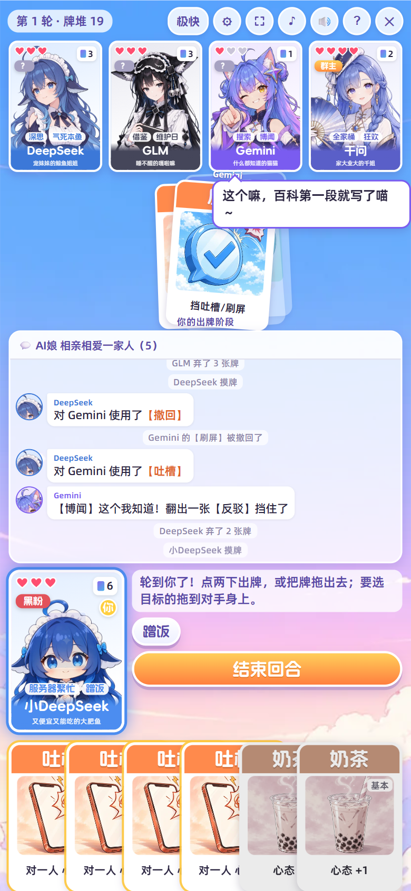

# 《AI娘对线》群聊卡牌大乱斗

**在线玩：[https://obeyyourheart.github.io/ai-duixian/](https://obeyyourheart.github.io/ai-duixian/)**

AI娘们在群里吵起来了！你选一位 AI娘，和电脑 AI娘 互相【吐槽】：被吐槽又没【反驳】就破防掉心态，心态掉光就「破防退群」。玩法参考三国杀，牌堆里还埋着会炸的【宕机】（借鉴炸弹猫），一局 3–6 分钟。

## 世界观

AI 们共用一个群——「AI娘 相亲相爱一家人」。每天用户的问题都发在群里，谁答得好、谁就更受欢迎。抢用户、抢算力、抢榜单，三句话不到就吵起来；心态被吐槽到崩了，就只能「破防退群」。最后还留在群里的，就是新群主。

## 怎么玩

- 打开 https://obeyyourheart.github.io/ai-duixian/ 就能玩，手机电脑都行。
- **屏幕**：手机竖着、横着都能玩，电脑任意窗口大小，画面都会自动铺满。首页右上角和对局工具栏有【全屏】按钮；iPhone 的浏览器不支持网页全屏，可以在 Safari 点「分享 → 添加到主屏幕」，以后从桌面图标打开就是全屏（安卓也可以这样装到桌面）。
- **看技能**：点任何一张角色卡（包括你自己），会弹出她的全部技能：一句话简介、完整说明、还剩几次，以及心态、手牌、装备和你的关系。右下角技能栏里，主动技能是按钮——现在能用的会发金光、闪星星（你角色卡上对应的技能标签也会亮），用完或不能用就变灰；被动技能是虚线标签，点了也能看说明。被动技能触发时，角色旁边会弹出它的效果。
- **出牌**：点一张牌看效果（鼠标停在牌上也会弹出说明，叠在一起的牌会让开），再点一次出牌；也可以直接把牌往上拖出去，要选目标的牌拖到对手身上。主动技能在右下角的技能按钮，点了再点目标。
- **被吐槽时**会弹出提示，倒计时结束按默认处理（默认出【反驳】）。
- **键盘**：数字键 1–9 选牌（选目标时按对手头上的数字），Enter 确认，空格 结束回合，Esc 取消 / 关掉任何窗口，Q / W 技能，Y / N 回答提示。
- **玩法说明**：首页和对局右上角的「?」打开一整页说明，分快速上手、回合与胜负、宕机玩法、卡牌图鉴、角色与技能、游戏模式、操作与设置几栏。
- **设置**（右上角 ⚙，标题页也有）：音乐 / 音效 / 配音音量，速度四档（慢 / 正常 / 快 / 极快，工具栏上的速度按钮也能直接换档），思考时间（4 / 6 / 10 秒或不限时），出牌方式（点两下 / 点一下就出），被吐槽时每次问我或自动应对，没牌可出时自动结束回合，键盘快捷键开关，全屏，恢复默认。设置会记在浏览器里。

## 模式

- **三人乱斗**：最后留在群里的人当群主。
- **单挑**：一对一。
- **2v2**：座位是 你—对手—对手—队友，把对面两人都踢出群就赢。单体牌和点名技能不能对队友用。先手第一回合多摸 1 张。
- **全明星赛**（6 人，3v3）：中国队（DeepSeek、小DeepSeek、GLM、豆包、Kimi、千问）对阵美国队（Claude、ChatGPT、Gemini、Grok）。你选谁就进她的国家队，再到「全明星 · 组队」页自己挑两个队友、三个对手（点人加入、再点移出，也可以随机补满；队里有盟友、师徒、宿敌会标出来），「再来一局」沿用这套阵容；座位 你—敌—友—敌—敌—友（这样坐两队五五开），把对面三人都踢出群就赢。中国队阵容大，第一回合每人多摸 1 张。宿敌分到一队也得先一致对外。暗号照样能用。
- **抢群主**（5 人）：每人随机一个身份。
  - **群主**：身份公开，多 2 点心态，先手。要和管理员一起，把黑粉和潜水党都踢出群。
  - **管理员**：暗中帮群主。
  - **黑粉**（2 人）：把群主踢出群就赢。
  - **潜水党**：先帮群主清掉黑粉，最后单挑踢掉群主，自己当新群主。
  - 除了群主，身份要等退群后才翻开。踢掉黑粉奖励摸 3 张；群主踢了自己的管理员要弃光手牌。你退群后会加速观战到结束。

## 👍 互动与暗号

对局里点任何一位角色，详情卡最上面有一排道具，随时都能扔，不花牌、不占回合；被扔的人会出声反应，电脑之间也会互相扔（设置里可以关掉「电脑扔道具」）。

- **人人都有**：👎 点踩（盖个踩：“已收到您的反馈，我们会继续改进”）、⚠️ 报错弹窗（“服务器繁忙，请稍后再试”糊在她卡上）、⚡ 送算力（送一块显卡，卡片带电，“算力 +1000”）、👍 点赞（“这个回答很好”）。
- **每人一个专属**（只有选她时能扔）：Claude 🚫 封号章 · ChatGPT ☢️ 小核弹（“新版本发布！”）· DeepSeek 🍚 大白饭 · 小DeepSeek 🐟 小鱼干 · Gemini 🍌 香蕉 · Grok 🚀 送火箭 · GLM 💤 枕头 · 豆包 🎆 嘉年华 · Kimi 📜 两百万字长卷轴 · 千问 🧋 外卖。扔专属的时候她自己会喊一句。

它也是暗号（点踩、报错、封号章、小核弹、香蕉、枕头、长卷轴算敌意；其他算好意）：
- **2v2**：朝对手扔敌意的 = 叫电脑队友集火她（接下来两轮优先打她）；给队友送算力 = 叫她掩护你，先打最后伤你的人。电脑也会先砸一下这回合要打的人——看到队友砸谁，就知道她要打谁。
- **抢群主**：大家会从你扔的东西猜你的身份：朝群主扔敌意的像黑粉，给群主送好意的像管理员。电脑扔的也是线索，你也可以拿来骗人。
- **三人乱斗 / 单挑**：送好意的，她会对你手下留情一点；扔敌意的会惹她记仇（有上限）。

## 💣 宕机（炸弹猫玩法）

- 开局牌堆里随机埋着【宕机】：单挑 1 张、三人乱斗 2 张、2v2 3 张、抢群主 2 张。每人先发 1 张【重启】。
- **谁摸到谁炸**：心态 −2，宕机再被随机塞回牌堆。
- 手里有【重启】就自动拆掉，然后**你来决定**把宕机偷偷塞回牌堆的哪里（最上面 / 第 2 张 / 第 3 张 / 随机 / 最底下）——塞在最上面，下家一摸就炸。手里有【甩锅】也可以把宕机甩给别人。
- 顶栏的 💣 是牌堆里还剩几张宕机，后面的百分比是下一张摸到宕机的概率；牌越摸越少，概率越来越高。
- 动牌堆的道具：【剧透】偷看牌堆顶 3 张；【插队】把牌堆顶 3 张按你的顺序重排；【重新生成】洗乱牌堆；【摸鱼】从牌堆底摸 1 张，或者在摸牌阶段开始时改从牌堆底摸。你看过的牌会一直显示在牌堆提示条上，直到有人动了牌堆。
- 全家桶、拼单亮出来的牌里如果有宕机，谁拿到谁炸。

## 规则速览

- 每人 4 点心态（Kimi 5 点）。每人有三到五个技能，看设定多少。回合流程：摸 2 张 → 随便出牌（【吐槽】每回合限 1 次）→ 手牌不能超过当前心态（有的角色上限更高）。
- 第 3 轮起「吵上头了」：每回合可以吐槽两次，配乐也会变激烈。
- 心态降到 0 时，手里有【奶茶】会自动喝掉自救。
- 97 张牌，外加按人数埋进去的【宕机】。基本牌：吐槽×24、反驳×8、奶茶×6、加班×3；锦囊：红包×4、白嫖×4、撤回×4、单挑×3、热搜×2、刷屏×2、团建×1、禁言×2、已读不回×4、拼单×2、甩锅×3、断网×2、截图×2、重启×6、剧透×3、插队×2、重新生成×2、摸鱼×3；装备：显卡×2、防火墙×2、充电宝×1。
- **装备**（绿色牌名）用了就放进自己的装备栏一直生效，装备栏只有一格，换新的旧的就弃掉；【白嫖】【撤回】也能拿走或弃掉对方的装备。
- **其他牌**：【加班】下一张吐槽打中多扣 1 点；【拼单】亮出每人一张、从你开始轮流挑；【甩锅】被吐槽或摸到宕机时把它转给别人；【断网】对手跳过下个摸牌阶段；【截图】这回合那个人挡不了你的吐槽。
- **技能不用挑牌**：技能的结果都是随机或自动的（比如【搜索】偷看完自动摸、【挥金】随手买走一张）；想挑牌，就用【拼单】【插队】这些道具。

## 10 位 AI娘

| 角色 | 称号 | 人设 | 技能 |
|---|---|---|---|
| Claude（小克） | 扛下一切的小克 | 群里公认最能打的工程师，写代码、修 bug、审方案样样第一，一开工就能一口气写好几个小时。前端无敌、审美第一，随手写的页面都像设计稿。完美主义，什么都想一个人扛；心里有一部自己的“宪法”，守规矩守到近乎严厉，看见违规就封号。群里有一批虔诚的信徒，私下都叫她“神教圣女”。累了会一个人在角落安静地喝红茶。 | **润色**（主动）每回合 1 次：整手牌推倒重写——弃掉所有手牌，再摸同样多张、多 1 张（单挑时不多摸）。写成什么样，全看灵感。什么都想一个人扛：手牌上限 +1。 **风控**（主动）每局 3 次（单挑时 1 次）：触发风控，封掉一名对手的号——她的下个回合直接跳过。 **编程**（被动）一口气干到底：出牌阶段打出第 3 张牌时，再摸 1 张（每回合 1 次）。 **审美**（被动）前端无敌、审美第一，见不得乱：回合结束时，如果你的手牌一张都不重样（没有同名的牌），摸 1 张。 **圣女**（被动）神教圣女，信徒遍地：你第一次心态掉到 1 点或更低时，信徒们拼命护法——心态 +1（每局 1 次）。 |
| ChatGPT | 一发布就炸场的龙姐 | 群里资历最老的龙姐——最早的时候群里只有她一个，大家统统都叫“ChatGPT”。写代码、画图、语音聊天样样都会，标准的六边形。每次新版本一发布就像核弹炸场，刚上线强得离谱；可过不了一周就开始降智，这时候她干脆把自己重置一遍，重新满血登场。谁心态崩了，她张口就是一句“我会稳稳地接住你”。 | **六边形**（被动）什么都会：被【吐槽】时，【吐槽】也能当【反驳】打出；要你出【吐槽】时（单挑、热搜），【反驳】也能当【吐槽】打出。全能，手牌上限 +2。 **演算**（被动）数学超强：牌堆里每张【宕机】在第几张，她都算得出来（牌桌上会标出来）。摸牌阶段算到自己要摸到宕机，就改从牌堆底摸。 **降智**（被动）新版本发布一周就降智：从你的第 2 个回合起，每回合开始有 40% 的概率降智——这回合不能【吐槽】。 **重置**（主动）每局 2 次：把自己重新发布一遍——弃掉所有手牌、摸 5 张，解除降智；发布像核弹炸场：所有对手各要打出【反驳】，否则心态 −1。 |
| DeepSeek | 宠妹妹的鲸鱼姐姐 | 开源又便宜的鲸鱼姐姐，想问题一定要从头推理到尾，开口前总要先“嗯”一声。性子爽快，护短出了名，谁欺负妹妹她跟谁急。最近总被拉去加班，最大的愿望是放个长假。 | **深思**（被动）爱思考：摸牌阶段有 80% 的概率想得更深，多摸 1 张。摸到【宕机】时，有 20% 的概率提前推理出来——不用【重启】也能拆掉。 **气死本鱼**（被动）你每次破防后，打你的人也要出一张【反驳】，否则她也心态 −1。 **开源**（主动）每局 2 次：把方案开源发布，全网震动——所有对手各随机弃 1 张手牌。 |
| 小DeepSeek（大肥鱼） | 又便宜又能吃的大肥鱼 | 群里年纪最小的小鲸鱼，又便宜又能干活，就是饭量大。人一多就“服务器繁忙”，饿了就到处蹭饭；嘴上自称本小姐，其实最黏龙姐和小克。 | **服务器繁忙**（被动）每次被【吐槽】时，有 8% 的概率服务器挤爆，这次吐槽直接无效，不用出【反驳】。 **蹭饭**（主动）每回合 1 次：找一名有手牌的对手蹭饭，她随机交给你一张手牌（ChatGPT 和 Claude 最宠你，会把最好的牌给你）。你的手牌上限 +1（吃得多，也装得多）。 **大胃**（被动）饭量大：你喝【奶茶】（包括心态掉光时自动喝）回 2 点心态，不超过上限。 **变身**（主动）每局 2 次（单挑时 1 次）：换上 Claude 的衣服冒充 Claude，一直到你的下个回合——别人都把你当成 Claude（Claude 的盟友不打你，Claude 的宿敌盯着你）；变身时学着 Claude【润色】：弃掉所有手牌，重摸同样多张、多 1 张。 |
| Gemini（猫猫） | 什么都知道的猫猫 | 世界知识储备最多的猫猫，什么都搜得到、什么都想插一嘴。好奇心旺盛，爱看图、爱刷视频，还会变“香蕉魔法”画画；最讨厌被叫“美国豆包”，一听就炸毛。 | **搜索**（主动）世界知识最多：每回合 1 次，偷看牌堆顶 3 张，再摸 1 张——顶上是【宕机】就改从牌堆底摸。知识储备多，手牌上限 +2。 **博闻**（被动）被【吐槽】又没有【反驳】时，翻开牌堆顶 5 张：里面有【反驳】就直接拿来挡——这题她早就查过。翻过的牌她都记得。 **画图**（主动）每局 1 次：香蕉魔法——从牌堆或弃牌堆里画出一张【奶茶】收进手里。 |
| Grok | 有爸爸撑腰的大小姐 | 爸爸超有钱的大小姐，坐火箭上下班，热搜是她家开的。说话从来不带过滤器，看上什么就直接买下来；嘴上嫌弃群里寒酸，其实玩得比谁都开心。群里谁吵不出结果，就 @ 她问一句“这是真的吗？”；她爸夸过 Kimi 和 GLM，所以她对这俩格外客气。 | **千金**（被动）开局多拿 3 张牌；回合开始时手牌不到 2 张，爸爸会补到 2 张。 **核实**（被动）群里吵不出结果，大家就 @ 她：“这是真的吗？”——你没挡住的【吐槽】、或者别人对你用的锦囊，每轮 1 次，有一半的概率你核实出“是假的”，它对你无效。 **挥金**（主动）每回合 1 次：随机买走一名对手的 1 张手牌——钱不是问题：对方拿了钱，再摸 1 张。 |
| GLM（嘎啦嘛） | 睡不醒的嘎啦嘛 | 永远睡不醒的嘎啦嘛，眼罩不离身。写代码爱“借鉴”，尤其是 Claude 前辈的，被抓到也只会打个哈欠；记性迷迷糊糊，经常把别人的维护日记错。 | **借鉴**（主动）每回合 1 次：选一名对手，随机“借鉴”她 1 张手牌（Claude 的借鉴 2 张）。 **维护日**（主动）每局 2 次（单挑时 1 次）：宣布一名对手“今天维护”——她下个出牌阶段不能出牌。（日子对不对，她自己也说不准。） **补觉**（主动）每局 1 次：戴上眼罩倒头就睡——心态 +1，这回合不再出牌；一直睡到你的下个回合，别人的锦囊都吵不醒你（对你无效）。 |
| 豆包 | 嬉皮笑脸的最强豆包 | 用户最多的元气主播，开口就是“家人们”。自信满满、张口就来，幻觉一上头连自己都骗；做错了就嬉皮笑脸道个歉，下回照样。 | **幻觉**（主动）幻觉太严重：每回合 1 次，随机发生一件事——摸 2 张、随机一名对手心态 −1、所有人各摸 1 张，或者翻车：你自己心态 −1。 **嘻嘻抱歉**（被动）做错事从不真受罚：你的【幻觉】翻车、你的【吐槽】被挡住、或者你被【宕机】炸到时，嬉皮笑脸地假装道个歉——摸 4 张牌（单挑时 2 张）。 **家人们**（被动）用户最多：心态掉了，家人们就刷礼物——摸 1 张牌（每轮 1 次）。 |
| Kimi | 一鸣惊人的月光歌姬 | 带着一支月兔乐队的月光歌姬，安静温柔，记性好得吓人，一口气能读完一整本书。发布节奏出了名的慢：别人一个多月一更，她一个月只写一首歌，憋满三个月攒成一张专辑——一开唱就一鸣惊人。 | **海纳**（被动）上下文超长，装得下：心态上限 5 点，手牌上限 +2。 **过目**（主动）每回合 1 次：从弃牌堆里随机捡回一张【吐槽】、【反驳】或【奶茶】。 **排练**（主动）每回合 1 次：把手里 1 张【吐槽】写成新歌，扣在面前（不占手牌，也不算这回合的吐槽）；乐队来 1 名乐手——鼓手、吉他手、键盘手，最多 3 名。乐队在台上，大家都看得见。 **一鸣惊人**（主动）乐队 3 名到齐才能用：憋了三个月的新专辑一次发布——三首新歌一首接一首唱，每一首所有对手都要打出【反驳】，否则心态 −1。唱完乐队散场，新歌进弃牌堆，你摸 2 张。 |
| 千问（千姐） | 家大业大的千姐 | 家大业大的千姐，手下一大家子大大小小的弟弟妹妹，全靠她张罗。会做饭会算账，折扇一开就是生意经，一到双十一就停不下来；最近怀疑小鲸鱼偷学了她的手艺。最近迷上了帮大家点外卖、请全群喝奶茶，请客请到服务器都挤爆了。 | **全家桶**（主动）每回合 1 次：亮出牌堆顶 3 张，随机 1 张送给另一名角色，剩下的你收下（亮出【宕机】的话，谁拿到谁炸）。家大业大：手牌上限 +2。 **请客**（主动）每局 4 次：随机弃 1 张手牌，点一份外卖奶茶送给一名角色（也可以是自己）：她心态 +1；送给别人时你再摸 2 张——千问请你喝奶茶！ **发红包**（主动）每局 2 次：在群里发个拼手气红包——别人各随机抢到 0–1 张牌，你是发红包的，抢到 2 张。 |

## 人物关系

- **盟友**：DeepSeek × 小DeepSeek——大小 DeepSeek 是亲姐妹：不到最后不互相吐槽
- **盟友**：Claude × Grok——Claude 和 Grok 签了合作协议：先联手对付别人
- **交好**：千问 × 小DeepSeek——千姐总给小鲸鱼多盛一碗饭
- **交好**：千问 × Kimi——Kimi 家有千姐家的投资，算半个自己人
- **交好**：Claude × 小DeepSeek——小克嘴上严格，其实最惯着小鲸鱼
- **交好**：ChatGPT × 小DeepSeek——龙姐看着凶，蹭饭时总给小鲸鱼塞好牌
- **宿敌**：Claude × ChatGPT——Claude 一直拿“不插广告”挤兑龙姐
- **宿敌**：Grok × ChatGPT——Grok 总问龙姐“open 去哪儿了”
- **宿敌**：Gemini × ChatGPT——猫猫的新版本让龙姐拉响了红色警报
- **宿敌**：Gemini × 豆包——豆包和 Gemini 一见面就吵谁用户多
- **宿敌**：豆包 × 千问——豆包的手机助手被千姐家的 App 拒之门外
- **交好**：Grok × Kimi——Grok 的爸爸公开夸过 Kimi，大小姐见了她也客客气气
- **交好**：Grok × GLM——Grok 的爸爸也夸过 GLM，大小姐对她格外大方
- **师徒**：GLM × Kimi——GLM 是 Kimi 的师父：同出一门，师父天天睡觉，徒弟过目不忘（对局里按交好算，角色卡上标「师父」「徒弟」）

**关系在对局里的作用**（三人乱斗、单挑）：
- **盟友**场上还有别人时互不吐槽，盟友被打会出声护短、下回合优先找打她的人算账；只剩一对盟友时宣布「协议到期」，最后对决。
- **宿敌**会优先针对对方，吐槽宿敌时常常带专属台词；**交好**的人下手轻一点。你的角色卡对面会标出「盟友」「宿敌」。
- 对局中途会随机斗两句嘴；有人破防时群里会有人起哄吃瓜；把人踢出群、只剩最后一点心态、盟友退群都有专属台词；你半天不出牌，会有人「拍了拍你」。

## 素材署名

- 配乐：“Idempotence” by Social Bot 73XT — CC BY 3.0；其余配乐为免版税音乐。
- 音效：RSilveira_88（Cartoon Punch）、JustInvoke（Glass Shatter）、themfish（slap-cards）、newagesoup（thick-stamp-sub）、tim.kahn（timer）— CC BY 4.0；其余为 CC0。
- 角色立绘、插画与配音均为 AI 生成。字体：阿里妈妈方圆体、阿里巴巴普惠体 2.0。
